<h1 align="center">Mailchilla</h1>

<p align="center">
Почтовый бот и веб-панель для <a href="https://github.com/MHSanaei/3x-ui">3x-ui</a>
</p>

<p align="center">


</p>

<p align="center">
<a href="README.md">English</a> · Русский
</p>

---

Пользователь пишет письмо с кодовым словом - получает готовую подписку. Админу открывать 3x-ui не нужно.

Проект начался с того, что надо было раздать подписки знакомым. Делать это через админку 3x-ui вручную - мучение, а Telegram-бот не вариант: как выдать подписку человеку, для которого Telegram заблокирован в РФ? Получается замкнутый круг - чтобы добраться до бота, который выдаёт подписку, подписка уже нужна. Почта работает у всех, без VPN и обходов. Вот через неё и сделано.

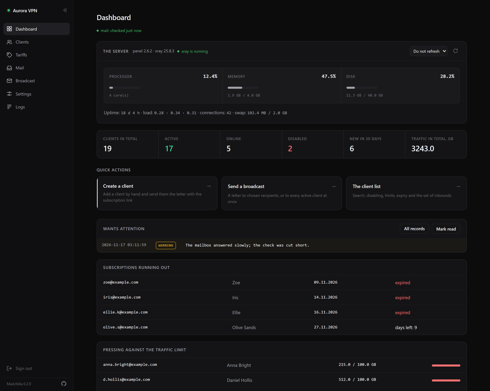

---

## Содержание

- [Возможности](#-возможности)
- [Быстрый старт](#-быстрый-старт)
- [Первый запуск](#-первый-запуск)
- [Тарифы](#-тарифы)
- [Настройки](#-настройки)
- [Доступ к панели](#-доступ-к-панели)
- [Управление](#-управление)
- [Обновление](#-обновление)
- [Как устроено](#-как-устроено)
- [Разработка](#-разработка)
- [Лицензия](#-лицензия)

---

## 📬 Возможности

**📧 Почтовый бот**

Пишешь письмо с командой (в теме или в тексте) - бот обрабатывает и отвечает.

| Команда | Что делает |
|---|---|
| кодовое слово | заводит клиента в 3x-ui, присылает ссылку подписки |
| `/status` | остаток трафика, срок, статус и устройства, зарегистрированные в счёт лимита, когда он есть |
| `/help` | инструкция по настройке клиентов |
| `/broadcast` | рассылка всем активным (только от админа) |

`/broadcast` выполняется, только если почтовый сервер ящика ручается за отправителя - SPF, DKIM или DMARC пройдены для адреса администратора. Один заголовок From может вписать кто угодно; без такого подтверждения ничего не рассылается, а администратору приходит письмо об этом. На Gmail, Яндексе и Mail.ru настраивать для этого ничего не нужно. Для собственного почтового сервера укажите его имя в Настройки → Почта → *Подтверждение отправителя* - то имя, которым он подписывает заголовки `Authentication-Results`; кнопка *Посмотреть в ящике* сама прочитает его из последних писем. Тогда заголовки этого сервера читаются целиком, на сколько бы штук он ни разносил свой вердикт, а заголовок с любым другим именем игнорируется; без имени читается только верхний заголовок, а на сервере, который для части писем не добавляет своего, верхним оказывается заголовок, принесённый отправителем. Письма от машин - отбойники, автоответчики, рассылки - читаются и остаются без ответа, и ни один адрес не получает больше десяти ответов в час.

Когда 3x-ui не отвечает, письма, которым он нужен, - регистрация, `/status`, рассылка - остаются непрочитанными и берутся снова при следующей проверке, а на `/help` и всё остальное бот отвечает сразу. Дашборд и лог сообщают, что письма ждут и почему; отказ панели принять токен или пароль называется именно так, потому что сам он не пройдёт.

Имя отправителя попадает в комментарий клиента - в списке видно людей, а не адреса. Для всех, кто зарегистрировался раньше, одна кнопка на вкладке «Почта» читает имена из уже лежащих в ящике писем и предлагает таблицу: кому проставить.

**🖥️ Веб-панель**

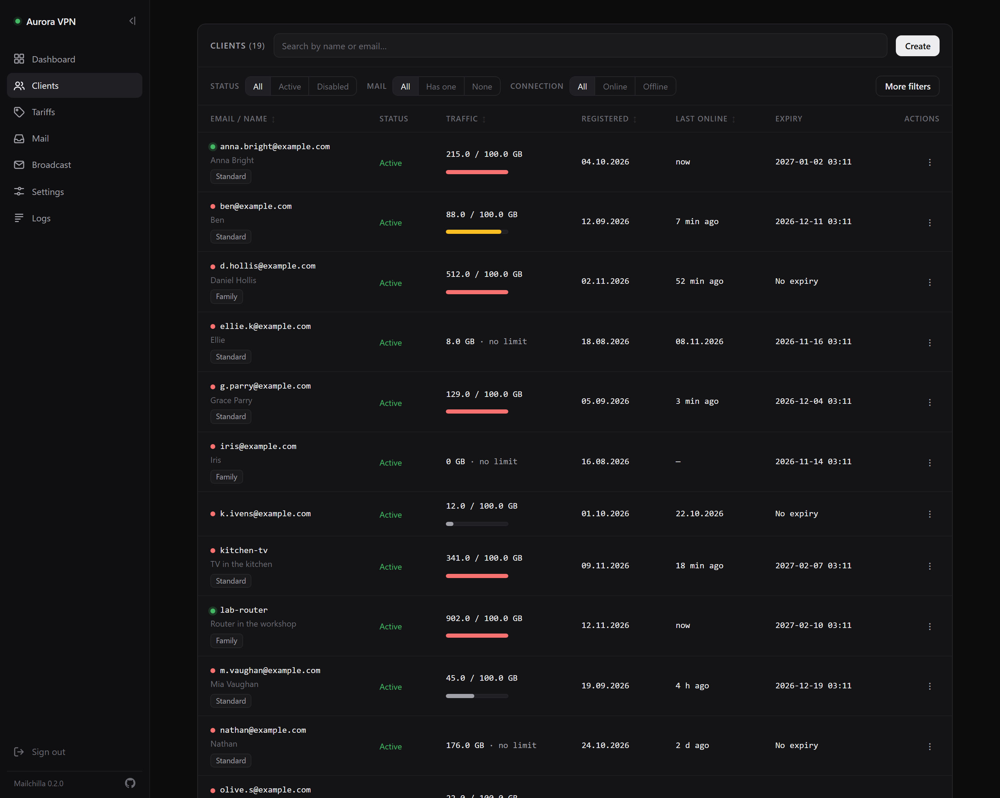

- Тарифы: трафик, срок и inbound'ы, у каждого своё кодовое слово. Сколько угодно, и клиента, заводимого руками, можно создать по тарифу
- Список клиентов с живым поиском, сортировкой и фильтрами (статус, почта, подключение, период, трафик)
- Кто сейчас на связи - точкой рядом с адресом: зелёная дышит, красная стоит. В списке, в карточке клиента и в списке получателей рассылки. Обновляется сама раз в двадцать секунд, ничего на странице не трогая
- **Был в сети**, отдельным столбцом и строкой в карточке: минуты и часы, пока свежо, дата - когда прошло больше недели, прочерк - для тех, кто не подключался ни разу. Точный момент в подсказке, столбец сортируется - так что те, кто перестал пользоваться, находятся в два клика
- Дашборд начинается с самой машины: процессор, память, диск, аптайм, состояние xray и сколько клиентов сейчас на связи. Может обновляться сам раз в несколько секунд или по кнопке. Рядом - как себя чувствует почтовый цикл: бот, который тихо перестал читать ящик, иначе выглядит ровно как ящик, в который никто не пишет, - и сколько человек на каком тарифе и сколько они съели
- Карточка клиента: трафик, срок, ссылка подписки, состав inbound'ов - даже выключенных и удалённых из панели
- У каждого inbound'а своя готовая ссылка подключения - та же строка, что отдаёт кнопка «копировать» в самой 3x-ui. Копируется одним кликом
- Ручное создание, изменение лимита, срока и состава inbound'ов, отключение
- Повторное приглашение и личное письмо - из карточки

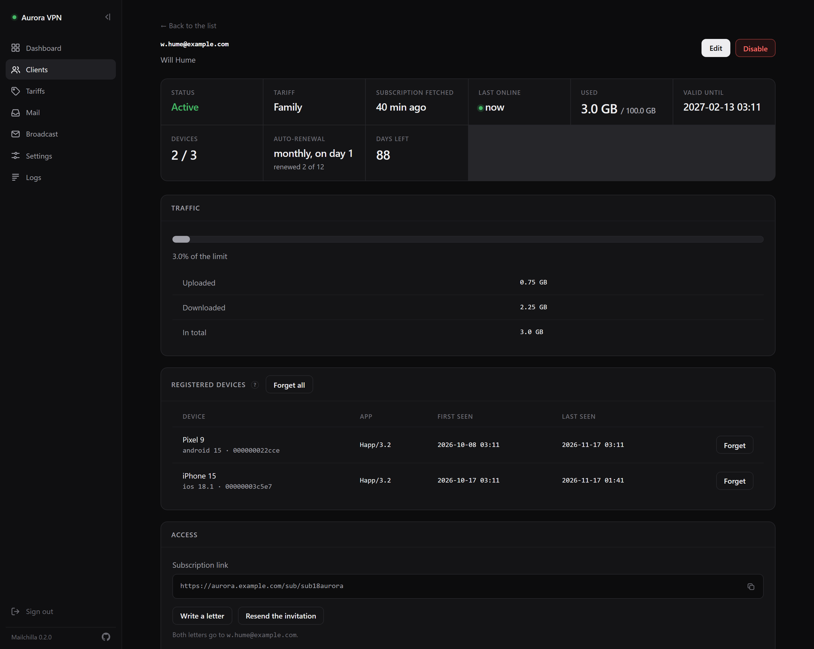

**📢 Рассылки**

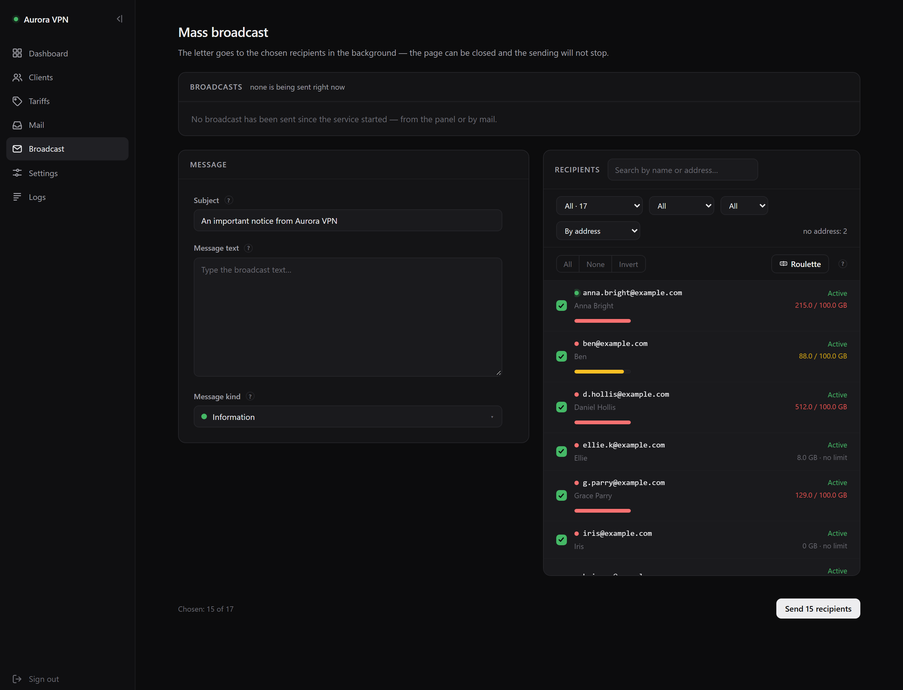

Письмо выбранным получателям или всем активным. Отправка в фоне, страница показывает прогресс, закрытие вкладки не ломает. Рассылка входит на почтовый сервер один раз и отправляет все письма через это соединение - каждое по-прежнему отдельным письмом на один адрес - а при обрыве посреди рассылки открывает его заново. На странице рассылки виден список: что отправляется прямо сейчас и что ушло до этого - сколько писем отправлено, сколько не доставлено и кому, - откуда бы рассылку ни запустили, из панели или письмом с `/broadcast`; пока письма уходят, на пункте меню дышит точка. Если нажать «Отправить», пока одна ещё идёт, панель сначала переспросит. Тип сообщения задаёт цвет полосы в письме: обычное, информация, предупреждение, срочное.

Список получателей: поиск, фильтры (активные, отключённые, лимит исчерпан, трафик на исходе), сортировка. «Все» и «Никого» действуют на то, что осталось после фильтра - набрать «всех, у кого кончился трафик» можно в два движения.

И совершенно несерьёзное: кнопка **«Рулетка»** раскатывает показанных получателей лентой, как открытие кейса в CS:GO, с цветами редкости, и оставляет отмеченным ровно одного. Редкость назначается по съеденному трафику, так что золото достаётся самому прожорливому.

**📮 Почтовый ящик**

Собственный ящик бота прямо в панели: входящие, отправленные и корзина, с поиском по адресу, имени или теме. Рядом с открытым письмом стоит написавший его клиент - статус, тариф, трафик, срок и слово, по которому он пришёл, в одном клике от карточки, - или простое «не клиент». В самом списке у писем клиентов виден тариф, так что свои люди с первого взгляда отличаются от всех остальных.

Ящик только просматривается. Открытое письмо не становится прочитанным: непрочитанное письмо - это то, по чему бот знает, что ещё кому-то должен ответ. HTML-письмо рисуется в закрытой рамке, где ничего из него не выполняется, а картинки с чужих серверов скрыты, пока вы о них не попросите - каждая сообщает отправителю, что письмо открыли. Вложения скачиваются, а не открываются в панели.

SMTP не хранит копий отправленного, поэтому бот теперь сам кладёт каждое письмо в «Отправленные» - если только провайдер не сделал этого сам, как Gmail. Письма, ушедшие до обновления, там не появятся.

К нему может добавиться второй ящик - Поддержка, настраивается на своей вкладке в Настройках. Как только заполнены обе половины (IMAP и SMTP), рядом с вкладкой бота появляется вкладка «Поддержка», и у каждого письма там есть форма ответа, которой у ящика бота нет - обычный текст, привязанный к письму, на которое отвечают, с цитатой снизу, и с копией в «Отправленные» той же папки, как и у любого другого письма. Когда ответ ушёл, письмо, на которое отвечали, помечается прочитанным и отвеченным - так по списку видно, с чем уже разобрались, а до чего ещё не дошли. Эта отметка - единственное, что эти страницы вообще меняют в ящике, и в ящике самого бота - никогда.

За ящиком поддержки никто не следит так, как бот следит за своим, поэтому при настроенном Gotify бот раз в минуту заглядывает в него и присылает уведомление обо всём, что пришло с прошлого раза: кто написал и о чём - по одному пушу на письмо, с заголовком и текстом, которые вы пишете сами, а если разом пришло больше пяти - пять самых новых и ещё один пуш со счётом остальных. Он только смотрит; ни одно письмо не помечается прочитанным. О письмах, которые уже лежали в ящике при первом взгляде, уведомлений нет, перезапуск не повторяет уже сказанное, а письмо, пришедшее, пока бот был выключен, будет объявлено, когда он вернётся. Переключатель и текст - на вкладке Gotify, рядом с текстом пуша о регистрации. Пока ящик не настроен, в разделе «Почта» ничего не меняется.

**💌 Письма**

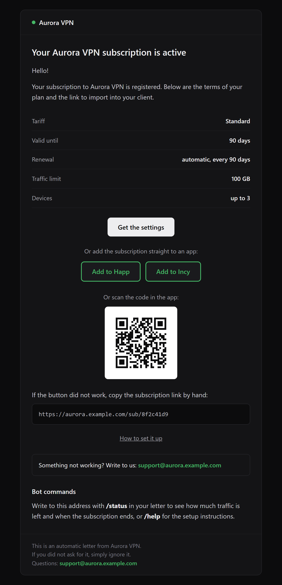

Вёрстка на таблицах с инлайн-стилями, плоские цвета, текстовая версия в каждом письме. Доходит одинаково в Gmail, мобильных клиентах и Outlook.

В приветственном письме есть QR-код со ссылкой подписки - для тех, кто открыл почту на компьютере и иначе переносил бы ссылку на телефон руками. Код рисуется на сервере и едет внутри письма: ничей сервис генерации QR не получает ссылки подписок ваших пользователей.

Письмо о регистрации начинается с того, что за подписка: тариф по имени, срок и лимит трафика. Имя берётся то, на котором клиент действительно находится - из его группы в 3x-ui, - поэтому уже зарегистрированному, написавшему слово другого тарифа, письмо назовёт то, что у него есть, а не то, что дало бы слово. У клиента, заведённого до появления тарифов, группы нет, и строки в письме тоже.

С письмами уезжают два ваших адреса, оба необязательные и оба задаются на вкладке «Основные». Адрес поддержки стоит в подписи каждого письма и отдельной строкой в письме о регистрации - там, где человек настраивает подключение впервые. Он кликабельный: нажатие открывает новое письмо, уже адресованное. Ссылка на инструкцию стоит в письме о регистрации под всеми способами подключения - кнопками, QR-кодом, ссылкой для копирования, - потому что читать идут после того, как попробовали.

Все тексты редактируются из панели: темы, заголовки, подписи, подвал, служебные сообщения. У каждого письма - кнопка тестовой отправки. То, что можно не отправлять - QR-код, ссылку на инструкцию, любую из строк поддержки, - собрано в рамки с собственным переключателем, рядом с тем текстом, за который он отвечает.

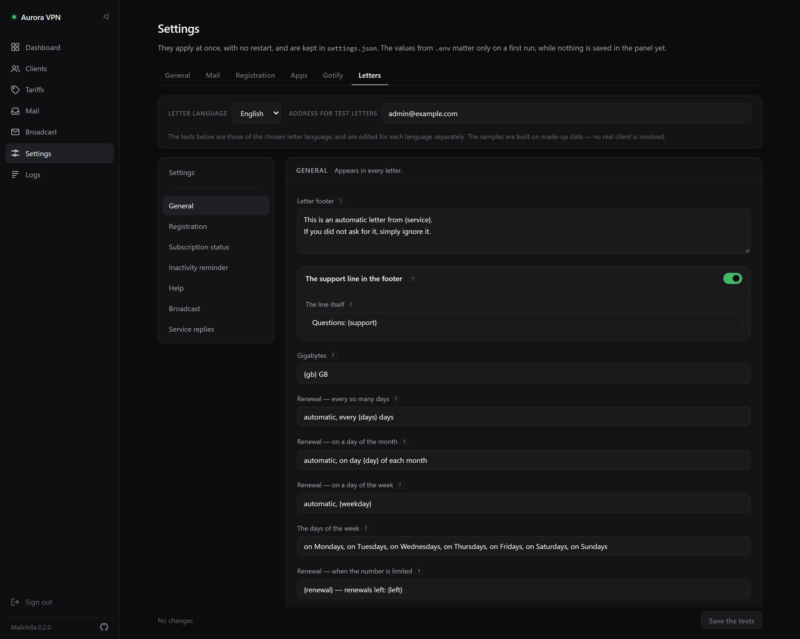

**📱 С телефона**

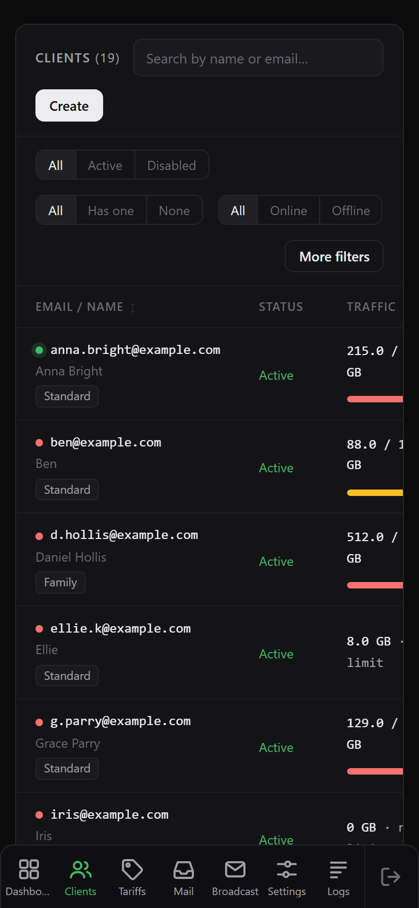

Панелью можно пользоваться с телефона, а не просто открыть её там. Боковое меню превращается в панель снизу, где ссылки не отнимают ширину и оказываются там, где и так лежит большой палец. Таблицы прокручиваются вбок внутри своей рамки, не утаскивая за собой страницу, а редактор писем, фильтры и рассылка складываются в одну колонку.

**🌍 Два языка**

Интерфейс говорит по-русски и по-английски. Письма тоже - и выбирается это отдельно, так что панель на английском может рассылать письма по-русски. Обычная ситуация, когда администрируешь на одном языке, а читают у тебя на другом.

Строки интерфейса лежат в `lang/`, тексты писем - в самой панели, своим набором на каждый язык. Правка английского приветственного письма русское не трогает.

**📋 Логи и уведомления**

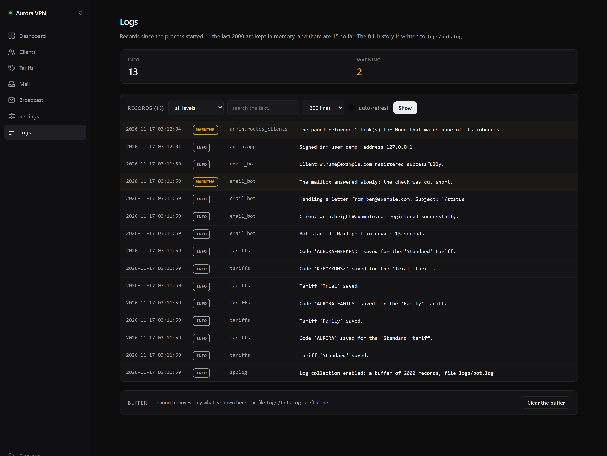

Логи процесса в браузере: фильтр по уровню, поиск, трассировки исключений. Непрочитанные предупреждения поднимаются на дашборд. Push в Gotify при каждой регистрации, при каждом письме, пришедшем в поддержку, и когда Xray на сервере останавливается - и ещё один, когда он снова работает.

Панель ещё замечает, когда вышла новая версия, и говорит об этом плашкой - со ссылкой на изменения и командой обновления. Сама она ничего не обновляет, а проверку можно выключить.

---

## 🚀 Быстрый старт

Одна команда на чистом сервере с доступной панелью 3x-ui:

```bash
bash <(curl -Ls https://raw.githubusercontent.com/vogster/3x-ui-mailchilla-bot/main/install.sh)
```

Установщик сначала спросит язык, затем доступ к 3x-ui и вход в собственную панель, а остальное сделает сам: пакеты, системный пользователь, последняя выпущенная версия в `/opt/mailchilla`, виртуальное окружение, `.env`, служба systemd и команда `mailchilla`. В конце напечатает адрес, пароль и команду туннеля.

Debian 12+, Ubuntu 22.04+, AlmaLinux/Rocky 9, Fedora. Нужен Python 3.10 или новее. В Debian 11 идёт 3.9, в Ubuntu 20.04 - 3.8, и установщик об этом скажет, а не оставит наполовину поставленную копию; на AlmaLinux и Rocky 9, где `python3` - тоже 3.9, он поставит рядом `python3.11` и возьмёт его.

Запускать скрипт из интернета от root стоит, посмотрев на него. Если так спокойнее:

```bash
curl -LO https://raw.githubusercontent.com/vogster/3x-ui-mailchilla-bot/main/install.sh && less install.sh && sudo bash install.sh
```

<details>
<summary><b>Установка вручную</b></summary>

Python 3.10+, доступ к панели 3x-ui.

```bash
git clone https://github.com/vogster/3x-ui-mailchilla-bot.git mailchilla
cd mailchilla
python3 -m venv venv
source venv/bin/activate
pip install -r requirements.txt
cp .env.example .env
# заполнить XUI_URL, XUI_USERNAME, XUI_PASSWORD (или XUI_API_TOKEN)
# заполнить ADMIN_PANEL_USER, ADMIN_PANEL_PASSWORD
# сгенерировать ADMIN_PANEL_SECRET: openssl rand -hex 32
python run.py
```

</details>

Одной командой поднимается и бот, и панель. Панель поднимается всегда - настраивать проект больше негде. Если нужен только бот: `python email_bot.py`.

В `.env` лежит только то, что нужно до запуска панели: доступ к 3x-ui, её собственный вход, адрес и настройки логов. Всё остальное - ящик, язык, Gotify - настраивается в панели после первого входа и хранится в `settings.json`, а то, что получает клиент, живёт рядом в тарифах.

---

## ⚙️ Первый запуск

Свежая копия ничего не знает про ваш ящик и inbound'ы. После первого входа наверху висит плашка с предложением пройти настройку.

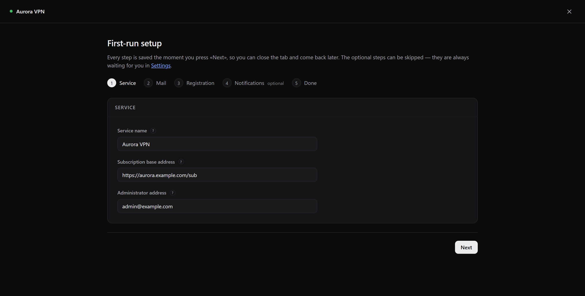

Мастер идёт по шагам: сервис, почта, inbound'ы и первый тариф, затем необязательные уведомления и приложения. Каждый шаг сохраняется сразу - закрытая вкладка ничего не теряет. На шаге с почтой работает проверка подключения.

Кнопка «Настрою сам» убирает плашку. Мастер - это те же поля настроек, разложенные по порядку.

---

## 🎟️ Тарифы

Тариф - это то, что получает клиент: трафик, срок и inbound'ы, в которые его добавляют. У каждого своё кодовое слово, и письмо с этим словом заводит отправителя именно на этом тарифе. Тарифов может быть сколько угодно - щедрый для своих, маленький пробный, закрытый вообще без слова.

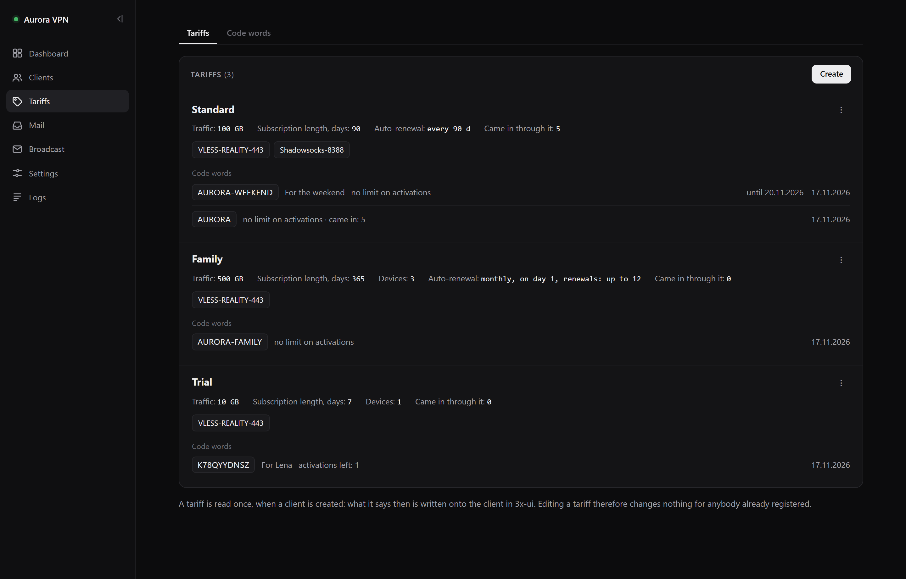

| Поле | Что значит |
|---|---|
| Название | для вас; под ним тариф виден в панели и в логах |
| Кодовое слово | слово, которое должно быть в письме. Не повторяется у разных тарифов, ищется целиком |
| Лимит трафика | в ГБ; 0 - без ограничения |
| Срок подписки | в днях; 0 - бессрочно |
| Лимит устройств | сколько устройств может пользоваться подпиской; 0 - без ограничения. Нужна свежая 3x-ui |
| Inbound'ы | клиент добавляется в каждый из них, по порядку |

Дашборд считает, сколько человек на каком тарифе и сколько они съели, рассылку можно сузить до одного тарифа, а `/status` называет клиенту его тариф. У каждого тарифа и каждого кода своя карточка: у тарифа видно, кто на нём сейчас, у кода — все, кто по нему пришёл, и от каждого один клик до его собственной карточки.

**Кто на каком тарифе — хранится в самой 3x-ui**, в группе клиента, названной по тарифу. Ничего не нужно держать в согласии: панель 3x-ui показывает ту же группировку, а изменённая там вручную группа — просто правда. В списке клиентов тариф виден рядом с именем, по нему есть фильтр, в том числе «без тарифа» — таким будет всякий, кто зарегистрировался до появления тарифов. Переименование тарифа переименовывает группу и переносит клиентов, поэтому названия тарифов не должны повторяться. Удаление тарифа не трогает его клиентов: лимиты у них свои, а метка переживает тариф - в списке она отмечена пунктиром, а на странице тарифов такие группы собраны в «Группы без тарифа».

**Лимит устройств ведёт сама 3x-ui**: она считает их по аппаратному идентификатору, который приложение присылает, когда запрашивает подписку. Устройство остаётся зарегистрированным, пока его не уберут, поэтому в карточке клиента есть их список - модель, система, приложение, когда впервые и когда в последний раз - и кнопка «забыть» для одного или для всех; это освобождает место для того устройства, которое попросит следующим, и это то, что нужно нажать, когда клиент пишет, что новый телефон не пускает. В письме о регистрации лимит указан, когда он есть, а `/status` отвечает, сколько устройств зарегистрировано из скольких, какие именно, и - когда все места заняты - что освободить место должен администратор. 3x-ui, вышедшая до таких лимитов, принимает клиента и молча отбрасывает лимит - бот перечитывает клиента, пишет об этом в лог и убирает строку из письма.

**Тариф читается один раз, в момент создания клиента.** Дальше значения живут у клиента в 3x-ui, поэтому правка тарифа ничего не меняет для уже зарегистрированных - он описывает следующего клиента, а не прошлого.

Про слово стоит знать две вещи. Оно ищется целиком, поэтому `START` не найдётся внутри `RESTART`; и ищется только в той части письма, которую человек написал сам, поэтому ответ с процитированным приветственным письмом не считается новой регистрацией. Если в одном письме слова сразу двух тарифов - бот не угадывает, а переспрашивает.

**Кодовые слова — отдельная сущность**, на своей вкладке рядом с тарифами. Код это слово, тариф, который оно открывает, сколько активаций у него осталось, заметка для вас и выключатель:

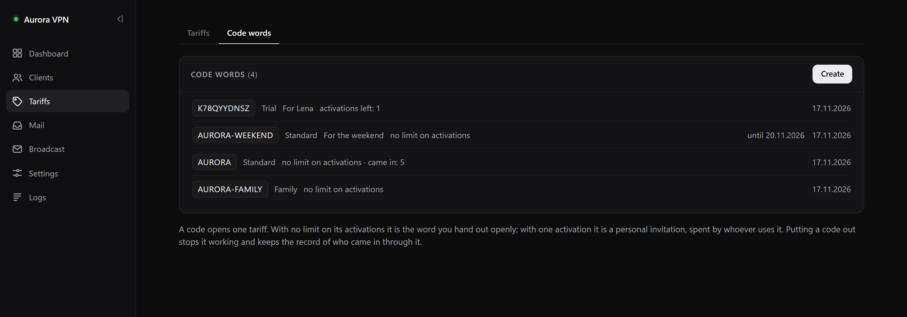

| Активаций | Что это |
|---|---|
| пусто | слово, которое раздают открыто - сработает у всех, кто его напишет |
| 1 | личное приглашение - гаснет на первом, кто им воспользуется |
| любое число | сработает столько раз |

У кода может быть и дата, до которой он работает, - последний день включительно. Слово, розданное на выходные, погаснет само, а не будет ждать, пока о нём вспомнят в понедельник; пустая дата означает, что код не истекает сам. Код, у которого кончились активации или дни, остаётся в списке зачёркнутым, вместе с записью о том, кто по нему пришёл.

Это число и есть вся разница между ними, поэтому форма одна. Кнопка **«Сгенерировать»** даёт неугадываемое слово - десять символов без `0`/`O` и `1`/`I`, его будут набирать руками, глядя в экран, - или впишите запоминающееся сами.

У тарифа может быть несколько слов: сезонное рядом с постоянным или по одному на компанию людей. Любое выключается отдельно в тот момент, когда утекло, не задевая ни тариф, ни остальные слова. Выключенный код сохраняет запись о том, кто по нему пришёл; убранный из списка - нет.

Если кодом воспользуется уже зарегистрированный адрес, код не гаснет: человек просто получит свою ссылку заново, а личное приглашение останется тому, кому предназначалось.

Тот, кто уже зарегистрирован, написав чужое слово, просто получит свою ссылку заново. Перевод клиента на другой тариф - решение администратора, а не того, кто узнал слово подороже.

Обновление с 0.1.x ничего не требует: старое кодовое слово, лимит, срок и inbound'ы на первом старте становятся тарифом «Основной», а все, кто зарегистрирован раньше, продолжают работать как работали.

---

## 🔧 Настройки

Всё, что меняется при эксплуатации, настраивается в панели и применяется на лету - без перезапуска.

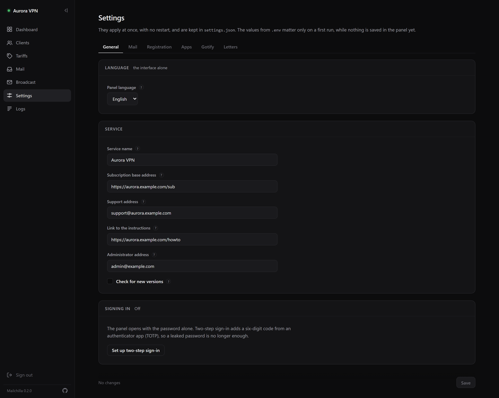

| Вкладка | Что внутри |
|---|---|
| **Основные** | язык интерфейса, название сервиса, базовый адрес подписки, адрес администратора, адрес поддержки, ссылка на инструкцию, двухэтапный вход |
| **Почта** | IMAP и SMTP: серверы, порты, логины, пароли, интервал опроса, имя почтового сервера для подтверждения отправителя, очистка ящика, проверка подключения |
| **Регистрация** | flow и записывать ли имя отправителя в комментарий клиента. Трафик, срок, inbound'ы и кодовое слово живут в тарифе |
| **Приложения** | схемы для кнопок «Добавить в Happ / Incy» в письме |
| **Gotify** | адрес сервера, токен, приоритет, текст пуша о регистрации; переключатель и текст пуша о письмах в поддержку и пуша об остановке Xray |
| **Письма** | язык, на котором уходят письма, все тексты всех писем, переключатель у каждого блока, который можно не отправлять, и отдельным пунктом рядом с шаблонами - напоминание притихшим клиентам |

На вкладке «Почта» есть проверка: панель входит в ящик по IMAP и на SMTP теми значениями, что в полях (сохранять не нужно), и показывает результат по шагам. Если задан адрес админа - уходит проверочное письмо.

Там же ящик можно держать в порядке. Читать его некому - на каждое письмо бот уже ответил, - а за год регистраций их набираются тысячи. Если включить, бот раз в заданное число дней переносит прочитанные письма в корзину, на том же соединении, которым и так опрашивает почту. Только прочитанные: флаг ставится после того, как письмо разобрано, поэтому непрочитанное - это письмо, которому ещё должны ответить, а после недоступности ящика там может лежать несостоявшаяся регистрация. Безвозвратно не удаляется ничего, так что слишком бодрый график можно отменить из почтового клиента, пока корзина не очистится сама.

На вкладке «Письма» рядом с шаблонами, в своём пункте меню, можно напоминать о себе притихшим клиентам. Если включить, бот с той же периодичностью, что и очистка почты, проверяет, кого 3x-ui давно не видел в сети дольше заданного срока, и отправляет соответствующее письмо с вопросом, всё ли в порядке. Для того, кто зарегистрировался и ни разу не подключался, срок отсчитывается от даты регистрации, а не пропускается за отсутствием записи о выходе в сеть. Проверка повторяется по расписанию, так что тому, кто так и не появился, напомнят снова, а не один раз.

Настройки хранятся в `settings.json`, тексты писем - в `email_texts.json`, тарифы - в `tariffs.json`, все три рядом с проектом. Почтовый ящик подхватывается на следующем цикле опроса.

**Секреты.** Пароли ящика и токен Gotify редактируются в панели. Пароли показаны точками и ничем больше, у токена видно по нескольку символов с краёв, чтобы отличить один от другого, и то и другое открывается кнопкой с глазом. В разметку страницы настоящее значение не попадает, оно запрашивается отдельно. Поэтому `settings.json` содержит секреты: файл в `.gitignore`, не давайте на него лишних прав.

---

## 🔐 Доступ к панели

По умолчанию `127.0.0.1:8080` - снаружи не открыть.

```bash
ssh -L 8080:127.0.0.1:8080 user@your-server
```

Открыть `http://localhost:8080`.

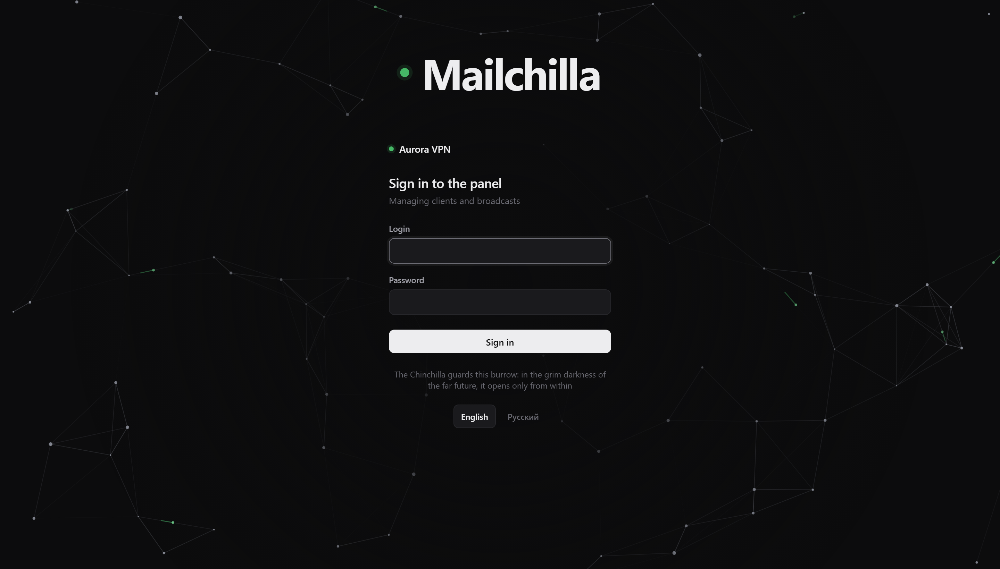

Альтернатива - reverse proxy с HTTPS. Ставить `ADMIN_PANEL_HOST=0.0.0.0` без этого не стоит.

**Двухэтапный вход.** Настройки → Основные → *Вход в панель* добавляет второй этап: шестизначный код из приложения-аутентификатора (TOTP - Google Authenticator, Aegis, 2FAS, менеджер паролей, подойдёт любое). Страница показывает QR-код, приложение его сканирует, и ничего не включается, пока приложение не выдаст верный код - поэтому несчитавшийся код не оставит вас за дверью. После этого один пароль панель не открывает. Код действует один раз, неверные заканчиваются после пяти за пять минут, и для выключения второго этапа тоже нужен код. Для нового телефона на той же странице есть *Настроить заново*: один код - и показывается новый QR-код, а старая запись работает, пока новая не выдаст верный код. Потеряли телефон? `mailchilla totp-off` на сервере снимает второй этап; для этого нужна консоль сервера - ровно то, чего украденный пароль не даёт.

---

## 🖥️ Управление

Команда `mailchilla` без аргументов открывает меню, а с аргументом выполняет то же самое действие - так она годится и для рук, и для скрипта.

```bash
mailchilla
```

| | |
|---|---|
| `mailchilla status` | служба, версия, отвечает ли панель |
| `mailchilla restart` | а также `start`, `stop` |
| `mailchilla log` | журнал, с продолжением |
| `mailchilla update` | проверить и поставить новую версию |
| `mailchilla passwd` | сменить логин или пароль панели |
| `mailchilla totp-off` | снять двухэтапный вход, если потерян телефон |
| `mailchilla port` | сменить порт |
| `mailchilla tunnel` | готовая команда SSH-туннеля |
| `mailchilla check` | войти в 3x-ui и доложить |
| `mailchilla backup` | копия конфигурации в `/opt/mailchilla-backups` |
| `mailchilla uninstall` | удалить всё |

`status` - это не `systemctl is-active`: с `Restart=always` служба, падающая в цикле, выглядит работающей, поэтому панель спрашивают по HTTP.

Забыли пароль от панели? Он лежит в `.env`, и без него панель вообще не стартует - `mailchilla passwd` задаёт новый и перезапускает.

<details>
<summary><b>Юнит systemd для ручной установки</b></summary>

```ini
[Unit]
Description=Mailchilla
After=network-online.target
Wants=network-online.target

[Service]
Type=simple
User=bot
WorkingDirectory=/opt/mailchilla
ExecStart=/opt/mailchilla/venv/bin/python run.py
Restart=always
RestartSec=10

[Install]
WantedBy=multi-user.target
```

Две вещи, на которых легко споткнуться:

- **Не используйте `EnvironmentFile` для `.env`.** Приложение читает его само через python-dotenv, а systemd разбирает по своим правилам - два парсера на одном файле разойдутся.
- **Пользователю нужны права на запись** в каталог проекта: туда пишутся `settings.json`, `email_texts.json`, `tariffs.json` и `logs/`.

</details>

---

## ⬆️ Обновление

```bash
mailchilla update
```

Версии - это теги, а не верхушка ветки: команда спрашивает у GitHub самый свежий `vX.Y.Z`, показывает изменения из `CHANGELOG.md` и ждёт подтверждения.

Прежде чем что-то трогать, она копирует `.env`, `settings.json`, `email_texts.json` и `tariffs.json` в `/opt/mailchilla-backups/<дата>/`. Если после перезапуска панель не отвечает - возвращается на прежнюю версию и восстанавливает их. Если зависимости новой версии не ставятся - возвращается ещё до какого-либо перезапуска.

**Версии 0.2.0 нужен Python 3.10**, тогда как 0.1.x работала на 3.9. Посмотрите перед обновлением:

```bash
/opt/mailchilla/venv/bin/python --version
```

На 3.9 обновление не пройдёт. Поставьте более новый Python рядом с системным - в AlmaLinux и Rocky 9 это `dnf install python3.11`; в Debian 11 такого пакета нет, и путь там - обновить систему, - затем пересоберите окружение на нём и обновитесь снова:

```bash
sudo python3.11 -m venv --clear /opt/mailchilla/venv && sudo /opt/mailchilla/venv/bin/pip install -r /opt/mailchilla/requirements.txt && sudo chown -R mailchilla: /opt/mailchilla/venv && sudo mailchilla restart
```

Файлы, поправленные на сервере (например, шаблон), не блокируют обновление: они откладываются через `git stash`, и команда скажет, как их вернуть.

Новые настройки и новые тексты писем не требуют миграции: отсутствующий в `settings.json` ключ берётся из умолчания в `config.py`, а `email_texts.json` хранит только то, что реально отличается от исходного текста. Тарифы тоже: установке без `tariffs.json` он собирается из кодового слова и лимитов, которые у неё уже были.

Для ручной установки прежний путь остаётся: `git pull` и `systemctl restart`.

---

## 📁 Как устроено

Собственной базы данных нет. Источник истины - панель 3x-ui, состояние клиентов читается оттуда. Это избавляет от рассинхронизации, но означает, что панель должна быть доступна.

| Файл | Назначение |
|---|---|
| `install.sh` | установщик: одна команда, русский или английский |
| `mailchilla.sh` | управление установленной копией: меню и подкоманды |
| `run.py` | точка входа: бот в фоновом потоке, панель в основном |
| `email_bot.py` | что значит письмо: команды, регистрации, ответные письма |
| `mailer.py` | отправка: сборка письма, SMTP, пуш в Gotify |
| `inbox.py` | чтение: цикл опроса IMAP и его самочувствие |
| `mailfolders.py` | ящик глазами панели: папки, письма, копии отправленных |
| `support_watch.py` | раз в минуту заглядывает в ящик поддержки и шлёт пуш о новом |
| `xray_watch.py` | раз в минуту спрашивает 3x-ui про Xray и шлёт пуш, когда ответ меняется |
| `broadcasts.py` | журнал рассылок: идущих и недавних |
| `xui_client.py` | клиент API 3x-ui |
| `templates.py` | сборка писем на Jinja2 - HTML и текстовая версия |
| `email_texts.py` | редактируемые тексты писем, свой набор на каждый язык |
| `i18n.py` | переводчик интерфейса: поиск по каталогу и два языковых параметра |
| `lang/` | каталоги интерфейса, по модулю на язык |
| `settings.py` | настройки поверх `.env` |
| `totp.py` | коды двухэтапного входа (TOTP, RFC 6238) |
| `tariffs.py` | тарифы и кодовые слова, которые их открывают |
| `config.py` | переменные окружения |
| `applog.py` | сбор логов в буфер и файл |
| `admin/` | веб-панель на FastAPI |
| `email_templates/` | шаблоны писем |

---

## 🛠️ Разработка

Форки и пул-реквесты приветствуются. Основная ветка - `main`.

```bash
pip install -r requirements.txt -r requirements-dev.txt
python -m unittest discover -s tests   # то же, что гоняет CI
```

Большая часть тестов ничего не поднимает - приведение настроек, поиск кодового слова, тексты писем. `tests/test_panel_routes.py` устроен иначе: он водит панель через `fastapi.testclient` с заглушкой вместо 3x-ui и существует ради одной конкретной поломки - шаблон читает ключ контекста, который роут не передал. Jinja молча превращает его в Undefined, страница всё равно рисуется, и пропажу находит тот, кто через неделю туда кликнет. Новая страница или новый ключ контекста заслуживают строчки в этом файле.

Прогон тестов оставляет каталог проекта таким, каким нашёл: каждый тестовый модуль начинается с `import sandbox`, который до любой загрузки переносит `settings.json`, `email_texts.json` и `tariffs.json` во временный каталог и отключает файл лога. Новому тестовому файлу эта строка тоже нужна, и `tests/test_sandbox.py` падает на файле без неё.

```bash
git checkout -b feature/my-feature
# ...
git push origin feature/my-feature
# открыть pull request на GitHub
```

---

## 📄 Лицензия

MIT - см. [LICENSE](LICENSE).
